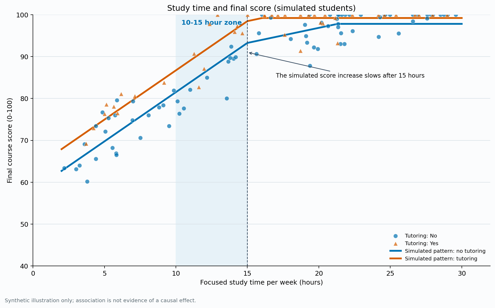

# Data Science Portfolio

I am a CISC7204 student developing practical skills in data cleaning, exploratory analysis, visualization, Python, and reproducible research. This portfolio brings together two proposal-stage projects and one completed simulation exercise.

## Projects

Each project has its own portfolio page:

1. [Open Proposal 1 — Seattle Rent and Mixed-Income Housing](proposal1/)
2. [Open Proposal 2 — College Tuition and Ten-Year Earnings](proposal2/)
3. [Open Learning Time and Learning Outcomes](learning-time-and-outcomes/)

### Proposal 1 — Seattle Rent and Mixed-Income Housing

[Open the Proposal 1 project page](proposal1/)

**Question:** How are mixed-income apartment counts associated with Seattle tract-level rents and rent growth?

The exploratory sample contains 3,931 positive-rent tract observations from 2001–2025. Mixed-income counts have a moderate positive association with rent levels, while their linear association with annual rent growth is close to zero. The tract-level analysis is descriptive and cannot establish causation.

**Status:** Proposal and exploratory analysis — ongoing.

[View project summary](proposal1/) · [Open source project files](https://github.com/mc66006/data-science-project/tree/main/proposal1)

### Proposal 2 — College Tuition and Ten-Year Earnings

[Open the Proposal 2 project page](proposal2/)

**Question:** Is annual tuition associated with median earnings ten years after entry, and does the pattern differ by institution type?

The filtered sample contains 1,731 predominantly four-year institutions. Tuition and ten-year median earnings are positively associated within both public and private institutions; the comparison is exploratory and does not measure an individual student's return.

**Status:** Proposal and exploratory analysis — ongoing.

[View project summary](proposal2/) · [Open source project files](https://github.com/mc66006/data-science-project/tree/main/proposal2)

### Learning Time and Learning Outcomes

[Open the Learning Time project page](learning-time-and-outcomes/)

**Question:** In a hypothetical student sample, how are study time and tutoring related to final scores?

In the simulated data, scores rise more quickly up to about 15 study hours per week and then more slowly. A tutoring offset is built into the data generator, so this is a programming demonstration rather than evidence about real students.

**Status:** Completed simulation-based demonstration.

[View project summary](learning-time-and-outcomes/) · [Open source project files](https://github.com/mc66006/data-science-project/tree/main/learning-time-and-outcomes)

## Skills practiced

Python, pandas, NumPy, Matplotlib, Seaborn, scikit-learn, Jupyter Notebook, data cleaning, exploratory data analysis, chart design, Git, and GitHub Pages.

## Reflection and next improvement

These projects gave me practice turning broad questions into measurable variables, checking data quality, and explaining what a chart can and cannot support. In the Seattle analysis, I compared rent levels with mixed-income counts and learned that a visible association should not be described as a housing effect without a stronger design. In the College Scorecard project, I practiced filtering institutions, handling suppressed values, comparing groups, and documenting confounding factors. The learning-time project let me build a reproducible pipeline from a fixed-seed synthetic dataset and inspect the score ceiling. My next improvement is to verify and cite the original Seattle data source and reuse terms, then strengthen the proposal analysis with clearly justified controls and validation. I also plan to ask a classmate to test whether the research questions, findings, limitations, and run instructions are clear, record their actual feedback, and identify the commit that responds to it.

**Peer feedback record:** Pending an actual classmate review; no feedback or response commit is claimed yet.
