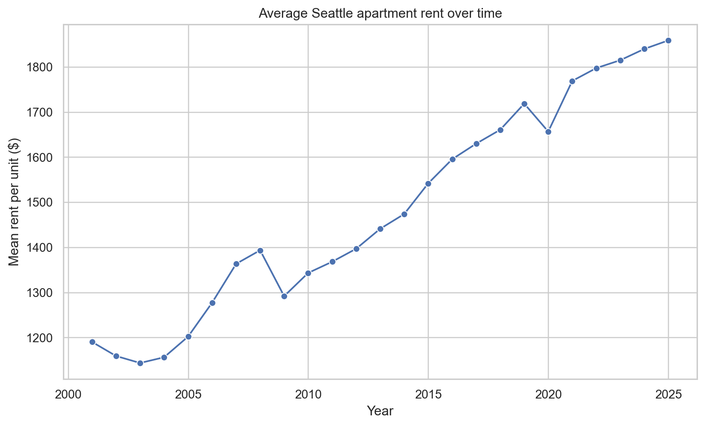
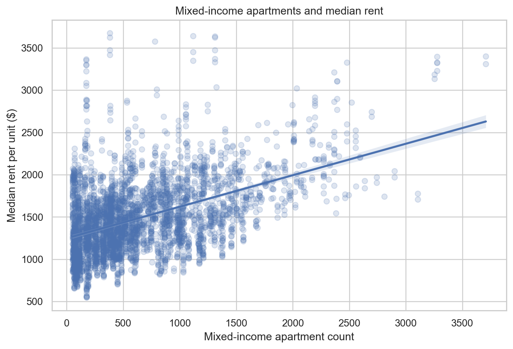
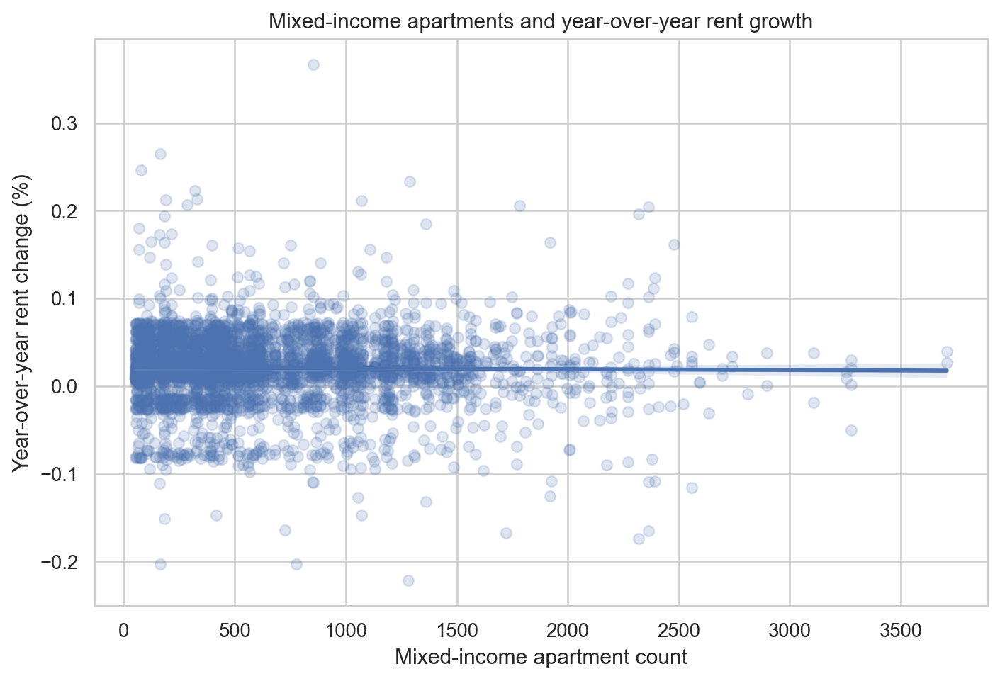
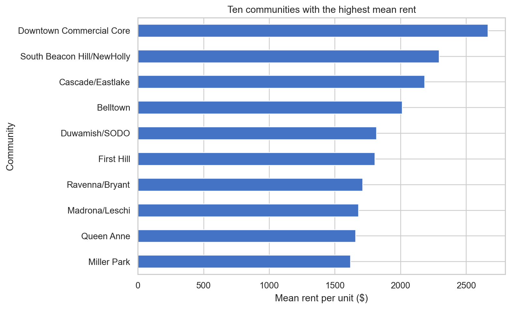

# Li WaiCheng | Data Science Portfolio

Hello! I am a CISC7204 student building practical skills in data cleaning, exploratory analysis, visualization, reproducible Python workflows, and responsible interpretation.

## Technical skills

Python · pandas · NumPy · Matplotlib · Seaborn · scikit-learn · Jupyter Notebook · Git · GitHub Pages

## Project showcase

### Seattle Apartment Rent and Mixed-Income Housing

**Status:** Completed course portfolio project; descriptive analysis with a reproducible script.

**Research question:** How are mixed-income apartment counts associated with median apartment rent per unit across Seattle census tracts from 2001 to 2025? Does the pattern differ for year-over-year rent growth, and how well can year, mixed-income count, and property count predict rent levels?

The project uses the City of Seattle's Apartment Market Rent Prices by Census Tract dataset. The cleaned analysis contains 3,931 tract-year rows from 2001–2025. Mixed-income count has a moderate positive correlation with rent per unit (r = 0.464) and a near-zero correlation with year-over-year rent change (r = -0.014). The simple random 80/20 regression benchmark has test R² = 0.422 and RMSE = $329.08. These results describe associations and prediction, not causal effects.

The main limitations are repeated observations for the same tract, omitted factors such as location and inflation, and the fact that market rent is not a complete affordability measure. A classmate's earlier feedback on my simulated study-time project noted that a 100-point score ceiling compressed high-hour observations. I addressed that feedback with a high-hour diagnostic in [analysis commit e8b49d6](https://github.com/mc66006/data-science-project/commit/e8b49d6) and published it in [portfolio commit 55836db](https://github.com/mc66006/data-science-portfolio/commit/55836db). That feedback applied to the earlier project; a new classmate review of this Seattle analysis would further strengthen the submission.

- **Project repository:** [CISC7204-MC66006-2026GitHub](https://github.com/mc66006/CISC7204-MC66006-2026GitHub)
- **Data source:** [City of Seattle Open Data](https://data.seattle.gov/dataset/Apartment-Market-Rent-Prices-by-Census-Tract/h27p-5k3i)
- **Feedback record:** [`FEEDBACK.md`](https://github.com/mc66006/CISC7204-MC66006-2026GitHub/blob/main/FEEDBACK.md)

## Reflection

This portfolio demonstrates practical skills in data cleaning, validation, exploratory analysis, visualization, model evaluation, reproducible scripting, repository organization, and responsible communication. I used the City of Seattle's Apartment Market Rent Prices by Census Tract dataset to examine how mixed-income apartment counts relate to rent levels and annual rent changes from 2001 to 2025. I checked required fields, converted numeric columns, removed rows with missing analysis values and non-positive rent, and created labelled figures for rent trends, community comparisons, and mixed-income relationships. In the cleaned sample of 3,931 tract-year observations, mixed-income count has a moderate positive correlation with rent per unit (r = 0.464), while its correlation with year-over-year rent change is near zero (r = -0.014). A simple random 80/20 regression benchmark has test R² = 0.422 and RMSE = $329.08. These results describe association and prediction, not causation. Repeated observations by tract can make a random split optimistic, and the analysis does not adjust for inflation, unit mix, vacancy, income, or other local conditions. My next improvement is a time-aware evaluation with inflation-adjusted rent and tract-level grouping. Earlier peer feedback on my simulated study-time project identified score-ceiling compression; I addressed it in commits `e8b49d6` and `55836db`. That feedback concerned the earlier project, so I would also seek a classmate's review of this Seattle analysis before final submission.

## Responsible sharing

The public project uses tract-level aggregate data, contains no passwords, API keys, or private individual records, and links to the City of Seattle source and its listed Open Data Commons PDDL licence.
