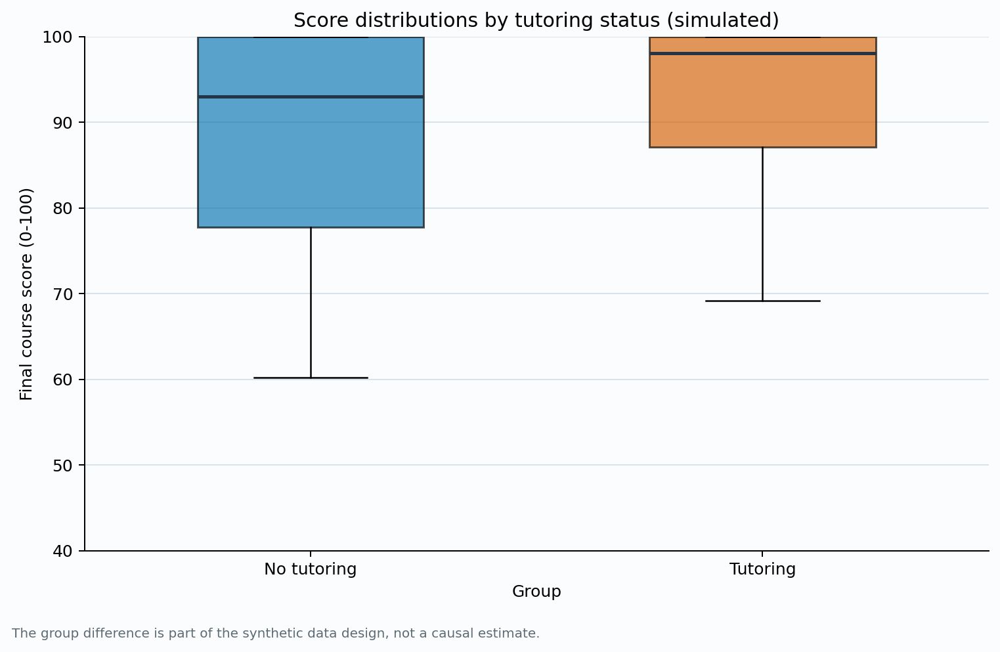
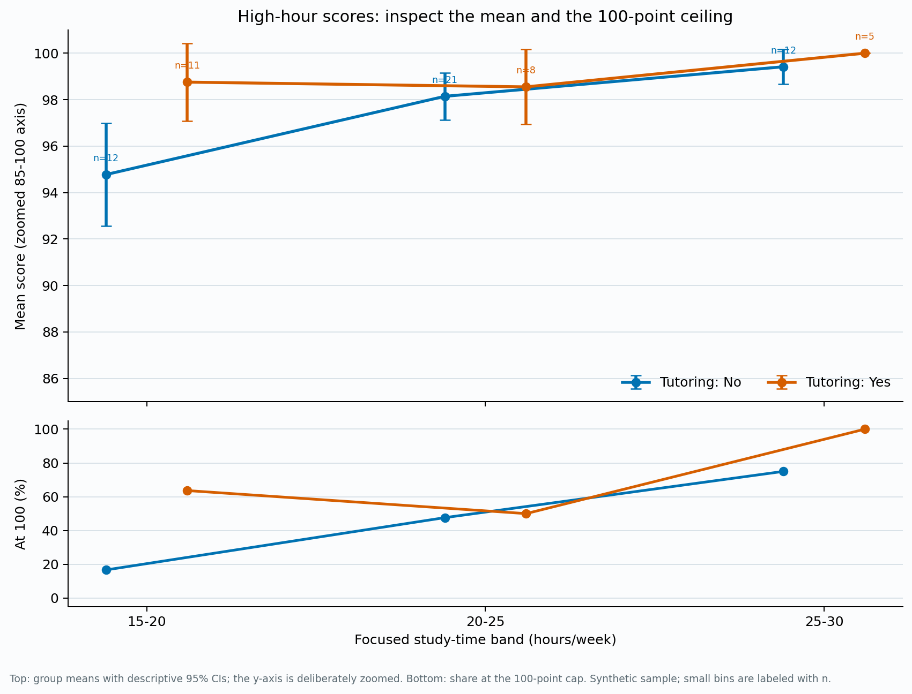

# Learning Time and Learning Outcomes

**Project status:** Completed simulation-based learning project.

## Research question

In a hypothetical student sample, how is focused weekly study time associated with final course scores, and how do scores compare between students with and without tutoring?

## Findings

The reproducible sample contains **120 simulated students**. Its data generator intentionally gives study time a steeper score relationship up to about **15 hours per week**, a smaller increase after that point, and tutoring an approximately **5.2-point** offset at the same study time before noise and score clipping. The charts make the designed pattern and the 100-point score ceiling visible. These are features of synthetic data, not empirical evidence about real students or a causal estimate.

## Limitation and reproduction

Because the records are synthetic and the relationships are chosen in code, the analysis cannot estimate real effects. A real study would need authorized student data, appropriate consent and privacy protections, and adjustment for prior preparation, course difficulty, and other factors.

The [project folder](https://github.com/mc66006/data-science-project/tree/main/learning-time-and-outcomes) includes the fixed-seed generator, synthetic CSV, figures, and run instructions. Install the listed requirements and run `python src/analyze.py` from that folder.

[Back to portfolio](../)
