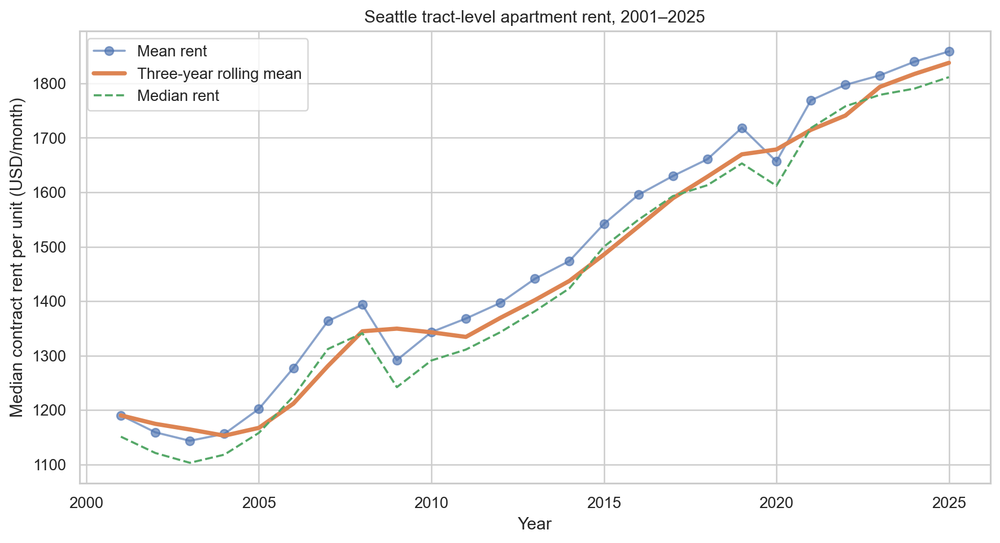
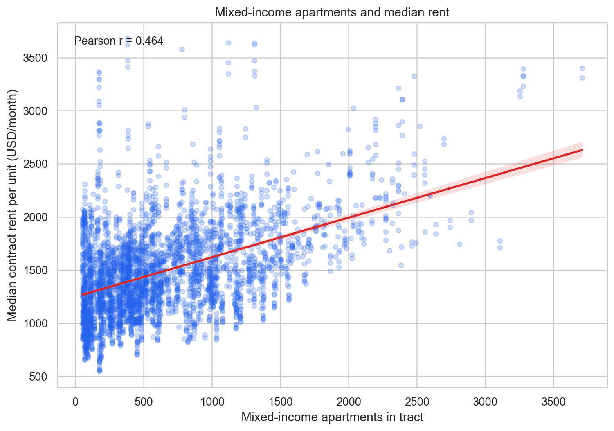
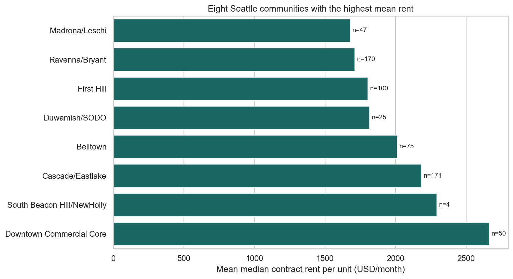
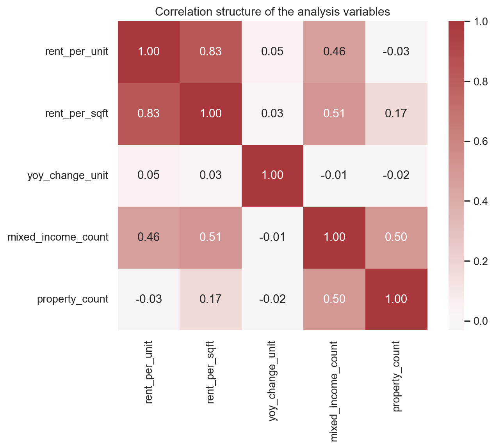

# Seattle Rent and Mixed-Income Housing

**Research question:** Across Seattle census tracts, how are mixed-income apartment counts associated with apartment rent levels and year-over-year rent growth?

## What the analysis shows

After excluding non-positive rent values, the exploratory dataset contains **3,931 observations across 160 tracts**, covering **2001–2025**. Mean monthly contract rent per unit is about **$1,486**, and the median is about **$1,432**. The tract-level count of mixed-income apartments has a positive association with rent level (**Pearson r = 0.464**), while its linear association with annual rent growth is close to zero (**r = -0.014**).

The charts show the time pattern, rent versus mixed-income counts, differences among high-rent communities, and correlations among the analysis variables. These are descriptive relationships; the analysis does not establish that mixed-income development causes rents to rise or fall.

## Visualizations

**What this figure shows:** The annual mean and median tract-level contract rent generally increase over 2001–2025. The three-year rolling mean smooths short-term changes so the longer upward pattern is easier to compare.

**What this figure shows:** Each point is a cleaned tract-year observation. The fitted line slopes upward, matching the moderate positive correlation between mixed-income apartment counts and rent level. It describes co-occurrence across tracts; it does not estimate a causal housing effect.

**What this figure shows:** The bars rank the eight communities with the highest observed mean median rent per unit. The sample counts printed beside the bars show that the comparison is based on different numbers of tract-year observations.

**What this figure shows:** The heatmap compares pairwise linear correlations among rent, rent per square foot, year-over-year change, mixed-income apartment count, and property count. It helps identify related variables before modeling, but correlation alone cannot establish direction or cause.

## Conclusion

In this exploratory sample, mixed-income apartment counts are moderately associated with rent levels (**r = 0.464**) but have almost no linear association with year-over-year rent growth (**r = -0.014**). The evidence supports further investigation of neighborhood and housing-stock differences rather than a causal claim. Because the data are aggregated by tract and the original data-use terms are not documented in the supplied archive, the next step is to verify provenance and add justified geographic and property controls.

## Limitations and data note

The records are aggregated by census tract and may be affected by tract size, neighborhood location, housing stock, and other unmeasured differences.

The rent table is the [Apartment Market Rent Prices by Census Tract](https://data.seattle.gov/d/h27p-5k3i) dataset in Seattle Open Data. Its portal description credits CoStar Group data prepared by the City of Seattle Office of Planning and Community Development. The companion [Single-Family Home Flips by Census Tract](https://data.seattle.gov/d/e9ve-4v8v) table is also available from Seattle Open Data and is based on King County Assessor records. These archived CSVs were downloaded for this coursework. The portal is publicly accessible, but current Seattle Open Data terms and any third-party restrictions should be checked before redistribution.

## Reproduce and explore

See the [project README](https://github.com/mc66006/data-science-project/blob/main/proposal1/README.md) for the methods and run instructions. The source folder contains the [analysis notebook](https://github.com/mc66006/data-science-project/blob/main/proposal1/seattle_rent.ipynb), proposal, CSV files, script, and generated figures.

**Project status:** Proposal and exploratory analysis — ongoing.

## Reflection

Working on the Seattle Apartment Rent and Mixed-Income Housing proposal taught me to turn a broad policy interest into a measurable question. I practiced inspecting census-tract records, standardizing column names and numeric fields, removing invalid rent observations, and checking how cleaning changed the usable sample. I used pandas and NumPy for preparation and summaries, then Matplotlib and Seaborn to show annual rent trends, tract-level associations, community differences, and correlations. Producing a standalone script alongside a Jupyter notebook made the work easier to reproduce. A classmate recommended adding plain-language explanations below each chart and a conclusion that tied the visuals back to the question. I made that improvement in commit a1179c6 by adding figure-by-figure interpretation and a conclusion to the portfolio page. The analysis suggests a positive association between mixed-income apartment counts and rent levels, but little linear association with annual rent growth. Since the data are aggregated and observational, these results do not show that mixed-income housing causes rent changes. The rent table comes from Seattle Open Data and credits CoStar data prepared by the City of Seattle; the companion flips table uses King County Assessor records. My next improvement is to confirm terms for both archived downloads, then add time, neighborhood, and housing-stock controls. This project developed my data cleaning, visualization, reproducibility, and cautious communication skills.

[Back to portfolio](../)
---
title: Proposal 1 - Seattle Rent
---

# Seattle Rent and Mixed-Income Housing

**Research question:** Across Seattle census tracts, how are mixed-income apartment counts associated with apartment rent levels and year-over-year rent growth?

## What the analysis shows

After excluding non-positive rent values, the exploratory dataset contains **3,931 observations across 160 tracts**, covering **2001–2025**. Mean monthly contract rent per unit is about **$1,486**, and the median is about **$1,432**. The tract-level count of mixed-income apartments has a positive association with rent level (**Pearson r = 0.464**), while its linear association with annual rent growth is close to zero (**r = -0.014**).

The charts show the time pattern, rent versus mixed-income counts, differences among high-rent communities, and correlations among the analysis variables. These are descriptive relationships; the analysis does not establish that mixed-income development causes rents to rise or fall.

## Visualizations

**What this figure shows:** The annual mean and median tract-level contract rent generally increase over 2001–2025. The three-year rolling mean smooths short-term changes so the longer upward pattern is easier to compare.

**What this figure shows:** Each point is a cleaned tract-year observation. The fitted line slopes upward, matching the moderate positive correlation between mixed-income apartment counts and rent level. It describes co-occurrence across tracts; it does not estimate a causal housing effect.

**What this figure shows:** The bars rank the eight communities with the highest observed mean median rent per unit. The sample counts printed beside the bars show that the comparison is based on different numbers of tract-year observations.

**What this figure shows:** The heatmap compares pairwise linear correlations among rent, rent per square foot, year-over-year change, mixed-income apartment count, and property count. It helps identify related variables before modeling, but correlation alone cannot establish direction or cause.

## Conclusion

In this exploratory sample, mixed-income apartment counts are moderately associated with rent levels (**r = 0.464**) but have almost no linear association with year-over-year rent growth (**r = -0.014**). The evidence supports further investigation of neighborhood and housing-stock differences rather than a causal claim. Because the data are aggregated by tract and the original data-use terms are not documented in the supplied archive, the next step is to verify provenance and add justified geographic and property controls.

## Limitations and data note

The records are aggregated by census tract and may be affected by tract size, neighborhood location, housing stock, and other unmeasured differences. The supplied coursework archive does not identify the original publisher or redistribution terms for the raw Seattle data; those terms should be verified before external reuse.

## Reproduce and explore

See the [project README](https://github.com/mc66006/data-science-project/blob/main/proposal1/README.md) for the methods and run instructions. The source folder contains the [analysis notebook](https://github.com/mc66006/data-science-project/blob/main/proposal1/seattle_rent.ipynb), proposal, CSV files, script, and generated figures.

**Project status:** Proposal and exploratory analysis — ongoing.

[Back to portfolio](../)
