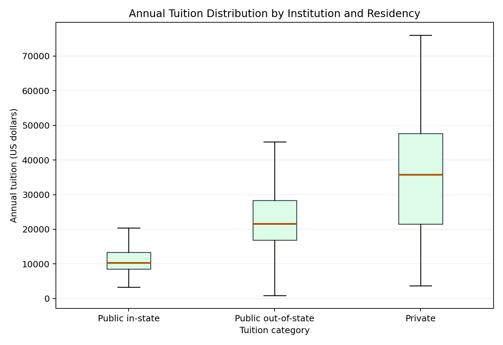

# Proposal 2 - College Tuition and Graduate Earnings

This proposal examines whether undergraduate tuition is associated with median earnings ten years after entry, comparing public and private four-year institutions.

- [Project materials](https://github.com/mc66006/data-science-project/tree/main/proposal2)
- [Back to portfolio](../)
